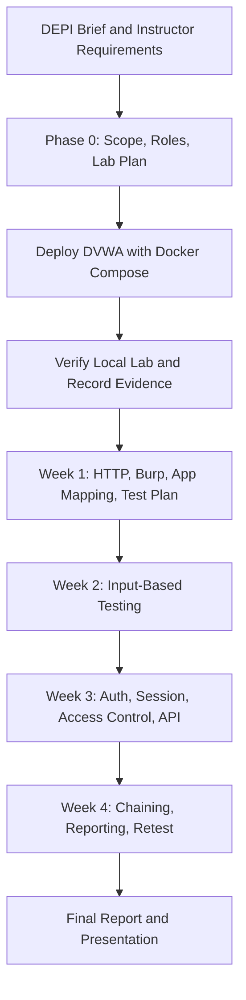
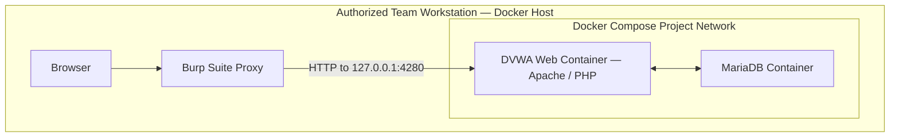

# DEPI Project 2 — Project & Lab Architecture

**Version:** 0.2 — Phase 0 handoff draft

**Updated:** 2026-11-13

**Target:** DVWA

**Deployment approach:** Docker Compose (selected; pending actual deployment evidence)

## 1. Purpose

This document describes the team's assessment architecture and the planned local DVWA lab. It is not a claim that the lab is already deployed and does not invent undocumented target internals.

## 2. Confirmed context

- DEPI Project 2: Web Application & API Penetration Test.
- Six team members.
- DVWA selected as the primary practice target.
- Docker Compose selected for the lab deployment.
- Two XMind planning maps completed: DEPI Project Phases and DVWA Target Architecture.
- Team Phase 0 target date: Sunday, 2026-11-15.

## 3. High-level project workflow

## 4. Planned lab architecture

The official DVWA project describes DVWA as a PHP/MariaDB web application. Its official Compose file defines a DVWA service and a MariaDB service, connected through a Docker network. The official Compose configuration maps the web container to the host loopback address on port 4280.

**Network restriction:** Keep the published port bound to `127.0.0.1`. Do not remove the loopback binding or expose the deliberately vulnerable application to the public Internet or LAN.

## 5. Practical implementation evidence required

The diagram above describes the intended design. It becomes an implemented architecture only after a team member records:

1. `docker version` and `docker compose version` output (versions only; no secrets).
2. `docker compose ps` showing the DVWA and database services running.
3. Browser screenshot showing DVWA loaded at the local URL.
4. Docker Compose repository commit/version used (`git rev-parse HEAD` in the DVWA clone).
5. Screenshot or text capture of the loopback-only port mapping.
6. Optional first HTTP request captured in Burp, with cookies/tokens redacted.

Record actual evidence IDs and the tester/date in `docs/DVWA_DOCKER_LAB.md`. Until then, deployment status remains PENDING.

## 6. DEPI testing lifecycle

- Week 1: HTTP/HTTPS fundamentals, Burp Proxy/Repeater/Intruder/site map, application map, request/response inventory, authentication/session flow, and test plan.
- Week 2: SQLi, XSS, CSRF, SSRF, file upload, path traversal, LFI/RFI; validate impact and false positives; provide PoCs where issues are actually confirmed.
- Week 3: JWT, session hijacking/fixation, IDOR/BOLA, broken authentication, excessive data exposure, rate limiting, business logic, and API request testing.
- Week 4: evidence-supported attack chains, final report, retest, remediation plan, demo screenshots/video, and executive summary.

## 7. API coverage note

The official DVWA README states that the API lab requires Apache `mod_rewrite` and Composer vendor dependencies. The team must verify whether those prerequisites are present in the chosen Docker deployment and record the result. If required Week 3 API areas are not supported by DVWA, document the gap and obtain instructor approval for a supplemental authorized lab rather than claiming unsupported coverage.

## 8. Repository and evidence architecture

- GitHub is the shared source of truth for project documents, sanitized evidence, issues, PRs, and decisions.
- Raw Burp projects, raw HAR/HTTP captures, credentials, cookies, tokens, private keys, and personal data must stay out of Git.
- Sanitized evidence is linked using stable IDs such as `SCR-001`, `REQ-001`, and `RES-001`.
- Every finding must be reproducible and traceable to evidence.

## 9. Open decisions

- Actual Docker host machine and installed versions.
- Exact DVWA commit/version deployed.
- API lab prerequisite status and coverage gap mitigation.
- Instructor's required architecture format and current acceptance status.
- Team role owners and reviewers.
