# **Reflected Cross-Site Scripting (XSS)**

# **Using DVWA and Burp Suite**

## Practical Web Application Security Assessment Report

Target Application: Damn Vulnerable Web Application (DVWA)

Testing Tool: Burp Suite Community Edition

Environment: 127.0.0.1:4280 (Local Lab)

# **1\. Project Overview**

This report documents a controlled, practical security assessment of the Reflected Cross-Site Scripting (XSS) vulnerability found in the "XSS (Reflected)" module of Damn Vulnerable Web Application (DVWA). DVWA is an intentionally vulnerable PHP/MySQL web application used for lawful security training. The target was hosted locally at 127.0.0.1:4280, and all traffic between the browser and the server was intercepted and analyzed using Burp Suite Community Edition's Proxy / HTTP History feature.

The assessment covers all three DVWA security levels available for this module — Low, Medium, and High — and evaluates how each level handles two common XSS payload techniques: a classic \<script\> tag payload and an \ tag using the onerror event handler.

# **2\. Project Objectives**

* Demonstrate how unsanitized user input in the "name" GET parameter can lead to Reflected XSS.

* Capture and analyze the raw HTTP GET requests and HTTP responses generated by each test using Burp Suite.

* Compare the effectiveness of DVWA's Low, Medium, and High security filters against two different payload vectors.

* Identify which payloads succeed, which are filtered, and which results are inconclusive and require further testing.

* Produce a clear, evidence-based academic report that does not assume results beyond what the screenshots and HTTP traffic actually prove.

# **3\. Tools and Technologies Used**

| Tool / Technology | Purpose |
| :---- | :---- |
| DVWA (Damn Vulnerable Web Application) | Intentionally vulnerable target application hosting the Reflected XSS module |
| Burp Suite Community Edition v2026.8 | Intercepting proxy used to capture, inspect, and replay HTTP requests/responses |
| Chromium-based Browser | Client used to submit payloads and observe rendered results / JavaScript alerts |
| PHP 8.5.11 / Apache 2.4.68 (Debian) | Server-side stack running DVWA, visible in the X-Powered-By and Server response headers |
| HTTP GET Method | Transport mechanism for the vulnerable "name" parameter |
| DVWA Security Level Cookie (security=low/medium/high) | Controls which server-side input filter is applied to the "name" parameter |

# **4\. Testing Methodology**

For each DVWA security level, the same two payloads were submitted through the "What's your name?" input field of the XSS (Reflected) page:

* Payload A (script tag): \<script\>alert('Reflected XSS')\</script\>

* Payload B (event handler): \

For every submission, the following evidence was collected: (1) the rendered browser output, including whether a JavaScript alert dialog appeared, (2) the raw HTTP GET request captured by Burp Suite — including the DVWA security-level cookie — and (3) the raw HTTP response returned by the server. A result was only recorded as "successful execution" when a JavaScript alert box was actually observed in the browser. An HTTP 200 OK status code was never treated, by itself, as proof that a payload executed, and an HTTP 404 response was never treated as proof that a filter blocked an attack, in line with the review requirements for this project.

# **5\. Practical Implementation and Screenshot Walkthrough**

The screenshots below are presented in the exact order they occur in the original evidence file. Each image is preceded by its number, a short title, and one sentence describing exactly what the image shows.

## **5.1 Low Security Level**

**Image 1: Baseline Reflected XSS Page**

*The DVWA "XSS (Reflected)" page is loaded with the Name field empty, before any payload has been submitted.*

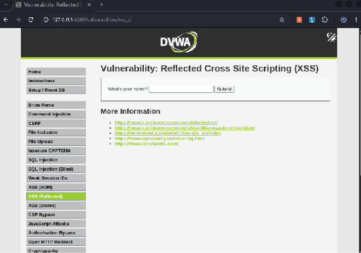

**Image 2: Script Payload Entered in the Name Field**

*The payload \<script\>alert('Reflected XSS')\</script\> has been typed into the Name field (the text box shows the tail end of the string because the field is not wide enough to display it in full).*

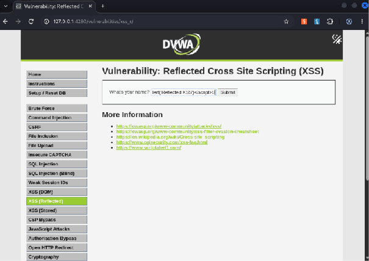

**Image 3: JavaScript Alert Confirms Execution**

*After submission, the browser displays a JavaScript alert reading "Reflected XSS", and the address bar shows the URL-encoded payload in the "name" query parameter, confirming that the script executed.*

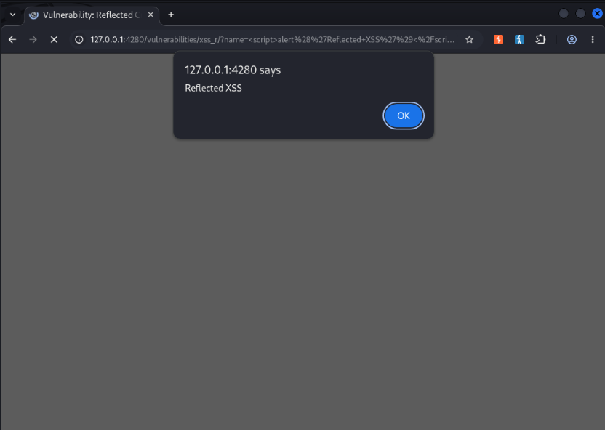

**Image 4: Page State Immediately After the Alert**

*After the alert dialog is dismissed, the page renders the word "Hello" followed by the reflected payload fragment, consistent with the input being echoed back without sanitization.*

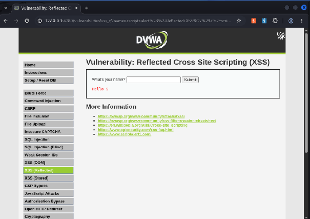

**Image 5: Burp Suite History and Request/Response for the Script Payload**

*The Burp Suite HTTP History shows the GET request for /vulnerabilities/xss\_r/ with the encoded script payload in the "name" parameter, returning an HTTP/1.1 200 OK response; the Cookie header in the Request panel carries security=low.*

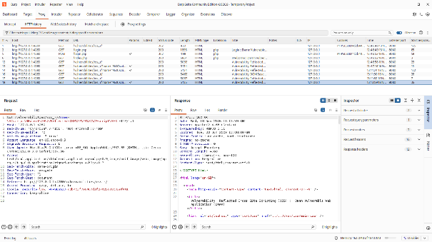

**Image 6: Zoomed Raw Request (Low Level)**

*A magnified view of the same request confirms the exact raw GET line and headers sent to the server, including the URL-encoded \<script\> payload.*

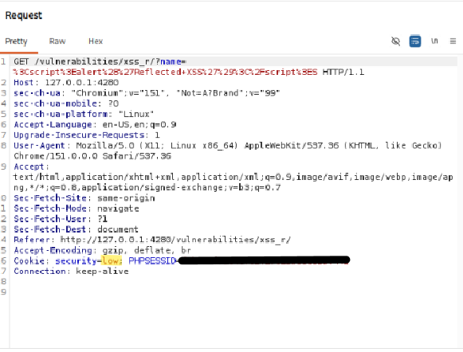

**Image 7: Zoomed Raw Response Headers (Low Level)**

*A magnified view of the corresponding response shows HTTP/1.1 200 OK, the Apache/PHP server banner, and the start of the returned HTML document.*

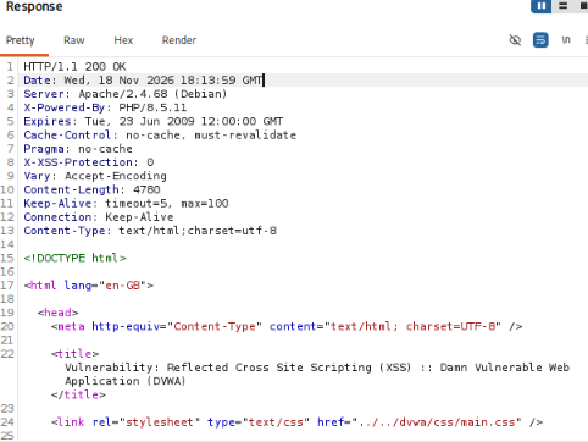

**Image 8: Alert Triggered by the Image Payload**

*Submitting the second payload, \, produces a JavaScript alert reading "XSS", and the address bar again shows the encoded payload in the "name" parameter.*

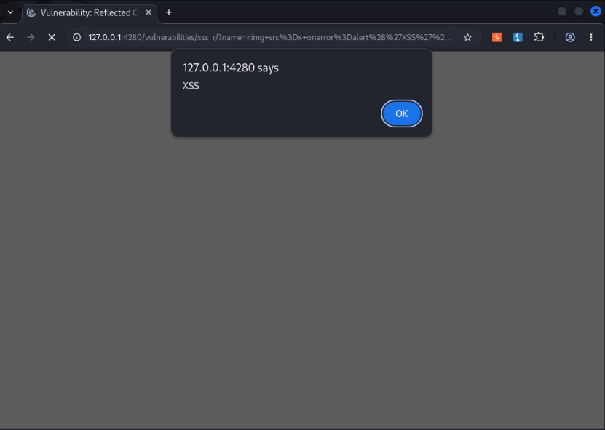

**Image 9: Page State After the Image Payload Alert**

*After the alert is dismissed, the page shows "Hello" followed by a broken-image icon, which is expected because the img tag's src=x attribute does not point to a real image; the broken icon is a normal rendering side effect, not an error.*

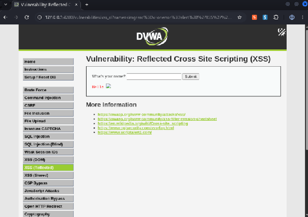

**Image 10: Unrelated 404 Not Found (Navigation Error)**

*A separate browser tab shows a "404 Not Found" response for the URL /vulnerabilities/xss\_r/x. This resulted from an accidental manual navigation to a mistyped path and is unrelated to the XSS tests; it is not evidence that any filter blocked an attack.*

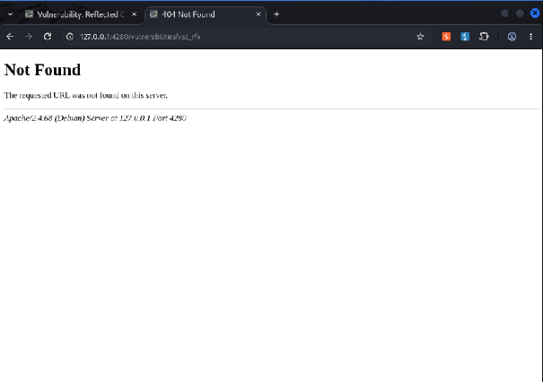

**Image 11: Burp Suite History Covering the Low-Level Test Set**

*The HTTP History shows additional entries for the module, including visits to the DOM-based XSS page, a POST to /security.php that (re)sets the level cookie to security=low, the GET request carrying the image-onerror payload under security=low (Request panel, highlighted), and the two 404 responses for the mistyped /xss\_r/x URL.*

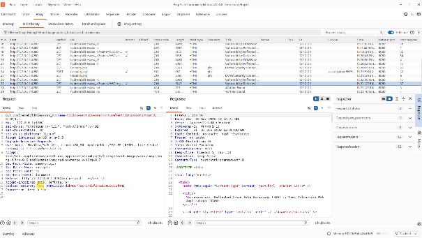

## **5.2 Medium Security Level**

**Image 12: Script Tag Filtered — Payload Rendered as Literal Text**

*The script-tag payload is submitted again, but this time the output reads "Hello alert('Reflected XSS')" with no \<script\> tags and no alert dialog, indicating that the Medium-level filter removed the literal substring "\<script\>" from the input and left the remaining text inert.*

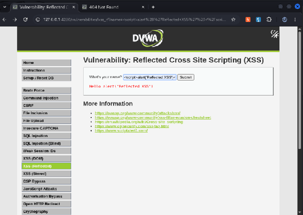

**Image 13: Alert Triggered by the Image Payload (Filter Bypass)**

*Submitting the \ payload again produces a JavaScript alert reading "XSS", showing that this vector is not caught by a filter that only strips the substring "\<script\>".*

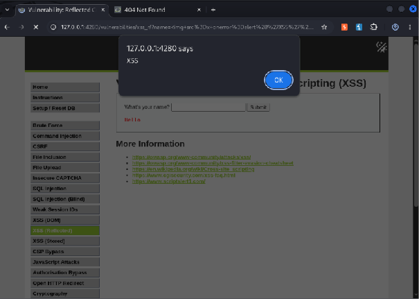

**Image 14: Page State After the Bypass Alert**

*After the alert is dismissed, the page again shows "Hello" followed by a broken-image icon, confirming the payload was reflected and executed.*

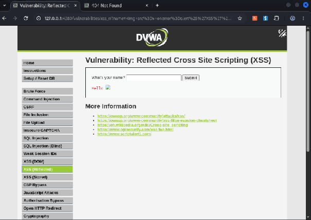

**Image 15: Additional Unrelated 404 Tabs**

*Two further browser tabs show the same "404 Not Found" error for the mistyped /vulnerabilities/xss\_r/x URL. As before, this is a navigation mistake, not a security control.*

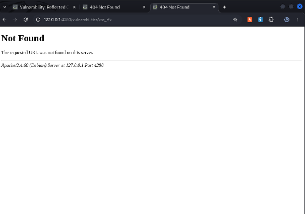

**Image 16: Burp Suite History and Request/Response (Medium Level)**

*The HTTP History lists the earlier script-tag request (marked "Edited", returning HTTP 200\) and the image-onerror request; the highlighted row's Request panel shows the Cookie header containing security=medium together with the image payload, with the Response panel returning HTTP/1.1 200 OK.*

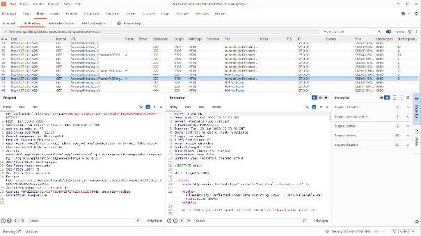

**Image 17: Zoomed Raw Request (Medium Level)**

*A magnified view of the request confirms the Cookie header value security=medium and the Referer header pointing back to the earlier script-tag attempt, showing the two tests occurred in the same session.*

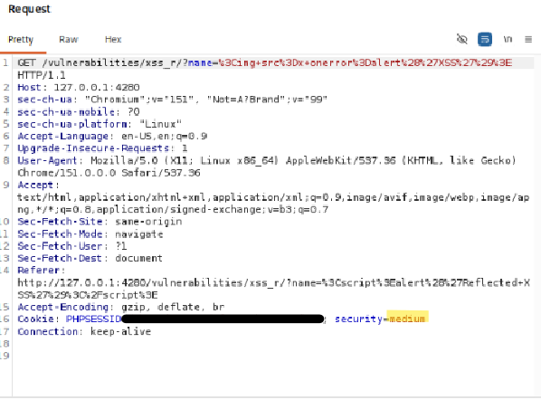

**Image 18: Zoomed Raw Response Headers (Medium Level)**

*A magnified view of the response shows HTTP/1.1 200 OK with the standard DVWA response headers and page title.*

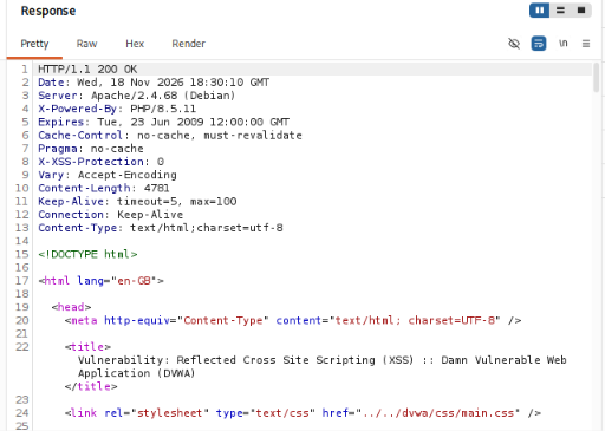

## **5.3 High Security Level**

**Image 19: Burp Suite Proxy Error (Inconclusive, Not a Block)**

*Burp Suite displays its own error page, "No response received from remote server", for a request containing the script-tag payload. This is a tooling/connection-level error, not an HTTP response from DVWA, and is therefore not evidence that the High-level filter rejected the payload; this specific attempt is inconclusive and would need to be repeated.*

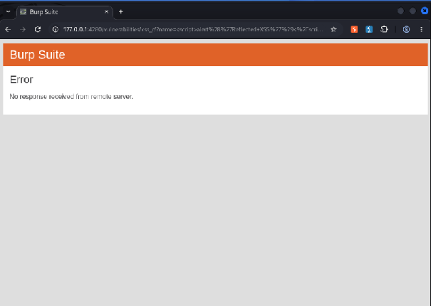

**Image 20: Alert Triggered by the Image Payload**

*A JavaScript alert reading "XSS" appears over the page, generated by resubmitting the \ payload.*

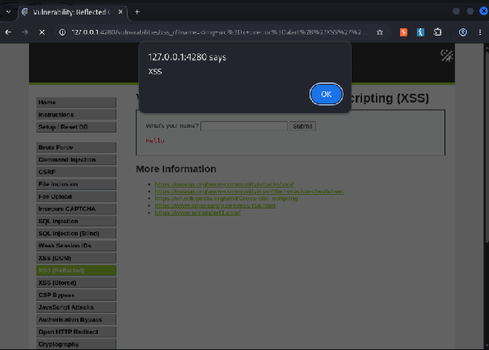

**Image 21: Page State After the Alert**

*After the alert is dismissed, the page shows "Hello" followed by a broken-image icon, the same pattern observed at the Low and Medium levels.*

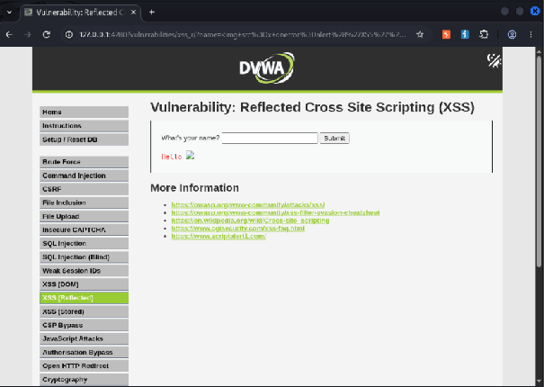

**Image 22: Burp Suite History Showing the Switch to High Level**

*The HTTP History shows the POST to /security.php whose response cookie sets security=high, followed by a GET request carrying the plain script-tag payload (HTTP 200\) and the GET request carrying the image-onerror payload (highlighted), whose Request panel carries the security=high cookie and whose Response panel returns HTTP/1.1 200 OK.*

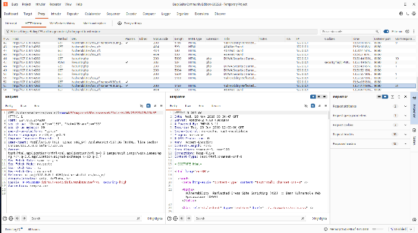

**Image 23: Zoomed Raw Request (High Level)**

*A magnified view of the image-onerror request confirms the Cookie header explicitly contains security=high.*

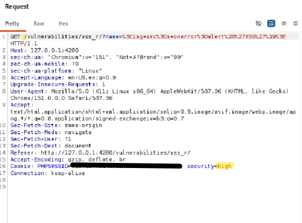

**Image 24: Zoomed Raw Response Headers (High Level)**

*A magnified view of the corresponding response confirms HTTP/1.1 200 OK and the standard DVWA response headers for this request.*

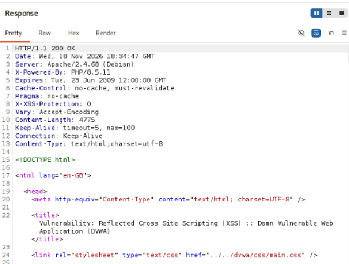

# **6\. Security Level Comparison**

The comparison below is based strictly on what was directly observed in the screenshots and the corresponding HTTP traffic. Where the evidence does not allow a firm conclusion, this is stated explicitly rather than assumed.

| Security Level | Script Tag Payload (\<script\>...) | Image onerror Payload (\) | Evidence |
| :---- | :---- | :---- | :---- |
| Low | Executed successfully (alert box observed) | Executed successfully (alert box observed) | Images 2–3, 8 (browser); Images 5–7, 11 (Burp, security=low) |
| Medium | Blocked / filtered — the "\<script\>" substring was stripped; no alert, payload shown as inert text | Executed successfully — bypassed the substring filter (alert box observed) | Image 12 (filter evidence); Images 13, 16–18 (Burp, security=medium) |
| High | Inconclusive — the test attempt returned a Burp proxy error ("No response received"); result requires a repeat test | Alert box observed; request confirmed to carry security=high | Image 19 (proxy error, inconclusive); Images 20–24 (Burp, security=high) |

*Note on the High-level script-tag result: because the only captured attempt at this specific combination ended in a Burp Suite connection error rather than an HTTP response, this report does not claim that the High-level filter blocked, allowed, or altered the plain \<script\> payload. A clean repeat of this single test, confirmed with its own screenshot and matching request/response pair, would be needed before drawing a conclusion.*

